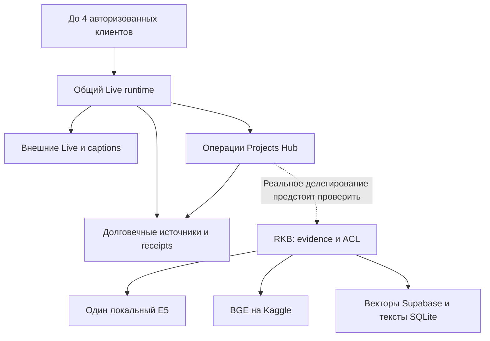

# Projects Hub: целесообразность Go/Rust при четырёх голосовых помощниках и RAG

Дата: **18 октября 2026**, время наблюдения сервера **09:42–09:47 Europe/Kaliningrad (UTC+2)**.

Статус: **исследовано и предложено**. Выполнены чтение кода, сохранённых отчётов и ограниченный снимок работающего сервера. Новые голосовые сессии, инференс, нагрузочные испытания и изменения production не выполнялись. Документ отвечает на отдельное поручение владельца о Projects Hub; проекты Smart Update Ultra и ускорения Astro остаются самостоятельными.

## 1. Решение

**Сейчас не переводить целиком Projects Hub на Go или Rust. Сначала завершить и квалифицировать уже разрабатываемый native voice v2, убрать конкретные блокировки и ограничить фоновые очереди в существующем Python-бэкенде. Затем проверить ровно целевую нагрузку: четыре голоса с captions, операции с проектами и настоящий RAG на общем сервере.**

Это не утверждение, что текущая версия уже выдерживает такую нагрузку. Полной приёмки этого сценария в исследованных материалах нет. Но нет и измерения, которое устанавливает Python как ограничитель. Есть более конкретные механизмы: синхронные обращения к хранилищу из async-кода, ожидание внешних операций под общими блокировками, неограниченная очередь RPC, внешние модельные соединения и очередь RAG. Перенос их без изменения устройства сохранит значительную часть ожиданий. [P03], [P06], [P08], [P09], [R06]

Если после этих исправлений именно локальные расходы Python мешают четырём разговорам:

- **Go — первый кандидат для цельного общего серверного voice runtime**, действительно заменяющего соответствующий Python-путь. Дополнительный proxy перед прежним runtime не даёт доказательства экономии всей системы.
- **Rust — кандидат для конкретного тяжёлого аудио/DSP-участка или подтверждённой проблемы аллокаций и хвостовой задержки.** Прежде нужно показать профиль такого участка: Opus/AAC уже обрабатываются нативными библиотеками.
- **Полный перенос продуктового бэкенда — отдельное решение.** Он имеет смысл, если после оптимизации измерена значительная стоимость всего backend либо принято самостоятельное решение о долгосрочной унификации. Для ускорения ожидания GitHub, DevCoveer или Kaggle достаточного основания сейчас нет.

Выбор Go для возможного цельного runtime — инженерная рекомендация по объёму интеграции и эксплуатации, не результат сравнительного теста Go против Rust. Фактическая экономия CPU, RAM и пользовательского времени остаётся неизмеренной.

## 2. Что именно проверено

### Версии и параллельная работа

| Объект | Зафиксированное состояние | Что это доказывает |
| --- | --- | --- |
| Projects Hub main | 57cc43a45e13218d47ad9623e6f2617a13fe7d20, merge #184 | Точный baseline анализа |
| Развёрнутый Projects Hub | /healthz: 0.1.62, тот же 57cc43a; systemd указывает каталог этого релиза | Свежий readback версии, не приёмку микрофона или RAG |
| Активная native-ветка, PR #175 | Draft, head 87a9ffd1e316ab7c0db3c979373185febd576272, повторно прочитан 18 октября | Параллельная работа продолжается; её нельзя перезаписывать отдельной миграцией |
| Shared live-interaction в manifest Projects Hub | c564f0c44c6fe783fd4932bd4633fada34e05c73, 0.4.0rc1 | Проверен именно этот shared-код |
| RKB main | 63cd565096913932cb42a93dbac3d3650e973169, 18 октября | Точный baseline RKB; исполняемый RKB SHA этим не установлен |

Backend Projects Hub — **Python/FastAPI/Uvicorn**. Node/Vite используется для PWA build. Стандартный запуск не задаёт несколько Uvicorn workers. На момент чтения process tree содержал один Python-процесс; позже могут появляться дочерние MCP bridges. Версию shared dependency нужно брать из manifest: некоторые повествовательные разделы README ещё описывают прежний релиз. [P01], [P02], [H01]

После первичного аудита PR #175 обновился с e30e3d6 до 87a9ffd. Проверенный diff меняет Android CI и emulator audio harness; выводы о deployed 57cc43a от этого не изменились. Отчёты старых прогонов остаются привязаны к своим SHA. [P18]

### Снимок общего сервера

Полные безопасные значения и ограничения сохранены в [JSON снимка](projects-hub-shared-host-snapshot-20261018.json).

| Показатель | Наблюдение |
| --- | ---: |
| MemTotal | 7 783 927 808 B = **7,25 GiB** |
| MemAvailable | 3 215 982 592 B = **3,00 GiB** |
| Использованный swap | 1 993 613 312 B = **1,86 GiB** |
| Свободное место файловой системы | 5 384 257 536 B = **5,01 GiB** |
| Load average, 1/5/15 минут | 1,40 / 1,71 / 1,88 |
| Projects Hub health | HTTP 200, 54 ms; версия совпадает с каталогом релиза |
| Фактические CPU quota/count, RSS/PSS по сервисам, PSI | В данном срезе не измерены |

**8 GB / 2 vCPU — исходный целевой бюджет владельца.** Количество и эффективная квота CPU свежим срезом не подтверждены. MemAvailable не равно гарантированному запасу при одновременном пике всех служб. Занятый swap сам по себе не доказывает активный thrashing, а load average не заменяет измерение загрузки CPU и ожидания I/O.

На хосте также наблюдались работающие RKB MCP, E5 encoder, Kaggle BGE lifecycle controller, graph discovery и automatic vector indexing. Названия и состояние не доказывают текущую нагрузку или функциональную приёмку. Из общей занятой памяти нельзя вычитать всю сумму как потенциальную экономию при переписывании Projects Hub. [H01]

## 3. Устройство нагрузки: четыре голоса — это не четыре локальные нейросети

Предлагаемая граница сохраняет одного семантического агента Mira на разговор, общий framework и продуктовую авторизацию. RKB возвращает доказательства центральной Mira; второй скрытый разговорный агент не добавляется. Связь с реальным RKB в стандартном запуске ещё требуется подключить и проверить — пунктир на схеме обозначает именно эту границу. [P17], [L05], [P12], [P13]

В native v2 клиент захватывает звук, применяет существующий VAD, кодирует его и отправляет сжатые бинарные WSS-фрагменты. Сервер сохраняет сжатые originals с receipts, получает **одну** декодированную PCM-проекцию и передаёт её основной Live-модели и отдельной caption-модели. На обратном пути provider PCM кодируется нативным codec, сохраняется и отправляется клиенту; факт отправки отделён от фактического playback. [P05], [P07], [L01], [L03]

Captions работают как отдельная asyncio task того же backend, а не отдельный Python-процесс. Однако имеют собственное внешнее соединение и resource lease. Поэтому четыре realtime-разговора с captions могут требовать **до восьми Google WSS-соединений и leases**, плюс обращения инструментов. Ускорение локального runtime не увеличивает квоту провайдера. [P03], [P04]

В admission defaults — 16 глобальных сессий и 2 на actor. Это защитные пределы, не доказанная ёмкость. Сценарий четырёх помощников следует проверять на четырёх разрешённых actor-контекстах. Если нужны четыре окна одного аккаунта, требуется согласовать действующую admission policy; обходить её ради успешного теста нельзя. [P03]

## 4. Что уже оптимизировано и где остаётся работа

### Голосовой framework и хранение

| Механизм текущего кода | Практический смысл |
| --- | --- |
| PyAV/FFmpeg для Opus/AAC | Тяжёлый codec уже нативный, не чистый Python-цикл |
| Общий codec pool: 2 workers / 4 jobs | Потоки не создаются безгранично на каждого пользователя |
| Общий дисковый executor: 2 workers / 8 jobs | Сжатые chunks сохраняются вне event loop; слот удерживается до фактического окончания commit |
| Один decoded PCM для Live и captions | Не нужно декодировать один источник дважды |
| Сжатые originals без постоянной второй PCM-копии | Уже сокращается объём долговечного аудио |
| Main input queue: 768 KiB; caption queue: 1 200 000 B | Присутствуют byte bounds, не только счётчики элементов |
| Output archive: 320 events, 256 KiB base64 payload, 2 s аудио | Несколько ограничений удерживают отставание выхода |
| История 320 events, tool-result cache 100 entries | Есть count bounds; распределение размеров payload ещё следует измерить |

Источники: [P04], [P05], [L01], [L02], [L03], [L04]. Это лимиты реализации, не результаты RSS-профилирования.

**Первоочередной остаточный механизм — синхронный доступ к общему store из async-пути.** В native on_event сохраняются transcript/timeline/source events через синхронные методы. Async HTTP handlers тоже непосредственно обращаются к store. Одна SQLite connection с WAL/FULL и общий threading.RLock используются в том числе дисковыми workers. Если worker удерживает lock на commit, event loop может ждать тот же lock и задержать другие разговоры. [P06], [P07], [P13]

Предлагаемое изменение: довести существующую ограниченную асинхронную границу хранения до всех относящихся к голосу операций. Убрать синхронное ожидание lock/fsync в event loop, сохранив порядок и **ACK только после фактического durable commit**. Это не предложение ослабить synchronous=FULL, потерять источники или отправлять запись в неограниченную fire-and-forget очередь. Перенос каждой операции в случайный новый thread также не заменяет общего ограничения.

Legacy PWA v1 всё ещё выполняет синхронный fragment write/fsync перед forwarding. Native v2 не означает, что старый путь исчез для всех клиентов. Решение о его выводе требует подтверждённого покрытия действующих клиентов и восстановления их записей. [P06], [P07]

В codec-коде остаётся Python Ogg CRC/framing. Это **кандидат для профилирования**, а не автоматически причина задержек. Если существенная стоимость подтвердится, можно заменить этот kernel проверенной native-реализацией, не переносить ради него весь продукт. [L03]

### Работа с проектами

Здесь основная ценность backend — контракты данных и внешних действий: actor/workspace ACL, private originals, expected revision, durable command ID, immutable snapshots, owner-only development, task reconciliation и receipts. HTTP handler составляет лишь часть работы. [P10], [P17]

| Находка в коде | Что предлагается изменить | Что необходимо сохранить |
| --- | --- | --- |
| DevCoveerClient: неограниченная asyncio.Queue; один stdio worker; timeout 35 s начинается после dequeue | Ограничить очередь и возраст ожидания, разделить queue wait и RPC time, объединять эквивалентные status reads | Владение MCP/AnyIO, ID исходной операции, readback после UNKNOWN |
| Collaboration держит async lock через awaited workflows, последовательно проходит до 8 jobs | Отделить долговечное принятие от внешнего ожидания, обеспечить справедливое обслуживание независимых операций | Защиту ревизий и порядок конфликтующих mutations |
| Development сериализует awaited transitions | Измерить длительные участки и сузить их serialization | Недопущение двойного coding-task dispatch |
| GitHub создаёт HTTPX client для каждого вызова | Переиспользовать безопасно настроенный connection pool | Корректные credentials и scope каждого запроса |
| Синхронные store-вызовы в async HTTP | Использовать тот же ограниченный store boundary | Транзакции и прочитанные revisions |

Источники: [P08], [P09], [P10], [P11], [P13]. Это механизмы кода; их вклад в сегодняшний wall time не измерен. Нельзя просто убрать locks: они защищают порядок и внешние эффекты. Note-processing уже повторно использует HTTP client, поэтому вывод о pooling относится не ко всем клиентам.

Например, _start_marked_codex_task читает историю перед запуском и после неопределённого ответа. Перенос, забывший это поведение, сможет быстрее создать **два** coding jobs вместо одного. Смена языка не заменяет эту защиту. [P10]

Shared runtime уже содержит correlated NON_BLOCKING progress для долгого инструмента после 2,5 s и подавляет устаревший progress после новой речи/Stop. Ожидаемое «Мира не молчит, пока работает инструмент» нужно проверить у реального провайдера; оно не требует второго LLM-router и не становится доказанным только из unit tests. [L02]

## 5. Совместная нагрузка с базой знаний региона

### Где находятся вычисления

| Часть | Текущее решение по проверенному RKB source | Что даст перенос Projects Hub |
| --- | --- | --- |
| Быстрый E5 encoder | Один локальный ONNX-процесс, последовательное обслуживание, очередь 10 | Не уменьшит веса и native working set E5 |
| BGE queries/documents/stories | Kaggle через actor-bound очередь | Не ускорит загрузку модели и внешнюю очередь |
| Книжный vector search | Supabase; локально ACL, исходники и hydration в SQLite | Не устранит сетевые/SQL ожидания |
| Live answer | RKB возвращает evidence: default 3, максимум 5; отвечает центральная Mira | Не ускорит внешний Live-инференс |
| Graph/indexing и coding agents | Другие процессы того же сервера | Их расходы останутся вне переписанного PH |

Источники размещения и ограничений в таблице: [R01], [R04], [R07], [R11].

В RKB уже принято и реализовано в коде **Kaggle-only BGE**. Исторические локальные BGE-прогоны не задают новую архитектуру; возвращать локальную BGE-модель ради четырёх разговоров не нужно. E5 остаётся отдельным локальным быстрым путём. Удалённые 585 569 350 B BGE weights в сохранённом отчёте — экономия **диска**, не измеренный объём освобождённой RAM. [R01]

Tracked E5 unit задаёт MemoryMax=2G, CPUQuota=100%, affinity CPU0. Это конфигурационные пределы исходного кода, не фактическое потребление и не свежий readback cgroup. Старые документы с hard limit 1 GiB нельзя выдавать за текущий лимит. Один E5 на четыре пользователя не превращается в четыре копии модели. [R02], [R08]

### Что важнее языка для времени RAG

Текущий main_search ограничивает ожидание BGE выражением min(config, remaining, 0.8): максимум **0,8 s**, хотя часть руководств ещё пишет 3 или 10 секунд. При неготовом Kaggle query возвращается доступное fast/lexical evidence и состояние pending/starting с job ID. Это управляемое ожидание, а не необходимость держать запрос до полной загрузки модели. [R03]

Но **жёсткий общий deadline 2 s пока нельзя считать доказанным**: E5 wait может достигать 3 s, vector pool wait — 3 s, SQL statement timeout — 5 s; в просмотренном верхнем search/search_evidence нет единого outer timeout. Эти интервалы не нужно складывать как измеренную задержку, однако локальные timeout не доказывают общий предел. Делегирующий voice-инструмент должен передавать оставшийся deadline и корректно завершать ожидание, сохраняя возможность прочитать исходный pending job. [R03], [R04], [R05], [R11]

BGE очередь ограничивает unfinished jobs, а serving run обрабатывает один claimed job за раз. Query приоритетнее document, но уже выполняющийся document job не прерывается. Burst из четырёх запросов нужно оценивать по queue wait, доле pending/fallback и качеству доступного evidence. Go/Rust в Projects Hub не делает внешний worker четырьмя workers. [R06]

### Существенная граница готовности интеграции

В Projects Hub regional_knowledge.py — типизированный delegated interface с нормализацией максимум пяти evidence и 24 000 символов. В нём нет embedding/index/HTTP/MCP transport. create_app(regional_knowledge_factory=None) и стандартный run_server.py не устанавливают реального delegated provider. Свежая systemd-конфигурация действительно запускает этот стандартный entry point. [P02], [P12], [P13], [H01]

Это устанавливает пробел стандартной конфигурации, а не запрещает наличие отдельного внешнего адаптера в другом deployment. До приёмки «4 голоса + RAG» надо подключить и проверить **настоящий авторизованный вызов RKB**. Подстановка пяти заранее подготовленных evidence измерит только часть адаптера. Закрытие этой границы — предмет совместимости текущих проектов, не довод за полную перепись.

## 6. Реалистичная количественная оценка

### Объём аудио сам по себе невелик

Для mono PCM16 полезная нагрузка равна sample_rate × 2 байта × число потоков. Это арифметика формата, **не измерение RSS** и не рекомендуемая задержка воспроизведения.

| Формат | 4 потока в одном направлении | Двухсекундный raw buffer этих потоков |
| --- | ---: | ---: |
| 16 kHz, PCM16 | 128 000 B/s | 250 KiB |
| 24 kHz, PCM16 | 192 000 B/s | 375 KiB |
| 48 kHz, PCM16 | 384 000 B/s | 750 KiB |

Четыре двунаправленных разговора с входом 16 kHz и выходом 24 kHz дают **320 000 B/s** логического raw audio и **625 KiB** на две секунды обеих сторон. Три полные копии такого буфера — около 1,83 MiB. Отдельная caption-передача добавляет ещё один upstream: при тех же 16 kHz это дополнительно 128 000 B/s на четыре разговора.

Base64 увеличивает n байт до 4 × ceil(n/3), приблизительно на треть до JSON. При 20 ms блоках четыре двунаправленных разговора дают 400 логических аудиоблоков в секунду; batching и captions меняют число реальных сообщений. Native client leg уже может передавать compressed audio, поэтому эти числа нельзя объявлять текущим сетевым трафиком.

Сумма byte limits только трёх перечисленных main/caption/output очередей из раздела 4 для четырёх сессий — около 8,58 MiB. Это **частичный бюджет payload, не общий предел памяти сессий или процесса**: отдельно остаются Python objects, JSON, SDK/TLS, codec contexts, другие очереди, история, источники и native memory. Но оснований считать гигабайты неизбежным следствием четырёх PCM-потоков нет.

### CPU нужно считать вместе с остальным сервером

Для целевых двух vCPU:

CPU_total = 4 × c_voice + CPU_RKB + CPU_projects + CPU_coding_agents + CPU_other.

Здесь c_voice — CPU-секунды на одну секунду полноценного разговора, включая нужные captions/storage/transport. Если условная стоимость одной сессии — 50 ms CPU/s, четыре потребляют 0,20 ядра; если 500 ms CPU/s — уже 2 ядра до RAG. **Ни одно из этих двух значений не является измерением Projects Hub.**

Голосовой backend может быть лёгким, а общий сервер всё равно перегружаться encoder, индексатором, сборкой, IDE или запущенным coding agent. Перевод Projects Hub не сокращает память и CPU другого процесса. Поэтому сначала нужны его собственные PSS/RSS, CPU и рост на сессию, затем тот же профиль всего хоста.

### Когда ускорение локального кода заметно пользователю

Пусть p — доля последовательного критического пути, которую действительно ускоряет перенос, k — ускорение этой части. Тогда отношение нового времени к старому:

T_new / T_old = (1 − p) + p / k.

| Иллюстрация при k = 5 | Новое полное время | Сокращение задержки |
| --- | ---: | ---: |
| Локальная ускоряемая часть 10% | 92% прежнего | 8% |
| 50% | 60% прежнего | 40% |
| 80% | 36% прежнего | 64% |

Это расчёт, а не прогноз языка. Реальная p неизвестна. При перегруженном CPU уменьшение обслуживания может дополнительно и сильно сократить очередь и p95/p99; простая формула этого нелинейного эффекта не моделирует. Поэтому отказываться от Go навсегда тоже было бы необоснованно. Нужно найти именно насыщение и критический путь.

### Сохранённые измерения проектов

| Источник и дата | Результат | Граница применимости |
| --- | --- | --- |
| PH audio research, 17 октября | Ingress conversion + primary/caption JSON: около 0,95 ms CPU на секунду аудио | Другой shared host; без SQLite/fsync, TLS, RKB и реального model path |
| Тот же исследовательский набор | Пример codec ролей сервера: 0,632 ms decode + 2,444 ms encode ≈ 3,08 ms CPU/audio-second | Арифметическая сумма отдельных проб; не joint benchmark DevCoveer |
| E5 production, 4 октября, 1/5/10 logical users | HTTP p95: 0,879 / 1,412 / 2,121 s; RSS: 490,5 / 490,6 / 490,7 MiB | Старый корпус и конфигурация; не сегодняшние четыре голоса |
| Kaggle BGE, 4 октября, 1/5/10 users | Public p95: 1,778 / 5,105 / 9,164 s | Старый режим ожидания, не нынешний 0,8 s fast-return |
| BGE при 10 users в том отчёте | Queue p95: 7,927 s; inference p95: 0,259 s | Показывает отдельную цену очереди; квантили нельзя складывать |
| BGE cold start, 4 октября | 73,686 / 75,370 s | Внешний запуск, который язык PH не устраняет |

Источники: [P15], [P16], [R08], [R09]. В первом исследовании использованы Python 3.12.14/libopus 1.4 и AMD EPYC 9V74; текущий deployed PH наблюдался на Python 3.14. Это не переносимый CPU benchmark. E5 passage batch4 в старом отчёте доходил примерно до 659 MiB RSS; нельзя считать 490 MiB универсальным максимумом.

Успешные RKB-прогоны 16 октября использовали впоследствии выведенный локальный BGE. Они полезны как история, но не доказывают нынешнюю Kaggle-only приёмку. [R10]

## 7. Go, Rust и оптимизация Python: сравнение решений

| Вариант | Возможная польза | Главная цена и ограничения | Решение сейчас |
| --- | --- | --- | --- |
| Оптимизированный Python + существующие native codecs | Устранение блокировки event loop, лишних копий и очередей с сохранением общей реализации | Не решит большой остаточный pure-Python CPU kernel, если тот подтвердится | **Первый выбор** |
| Цельный shared voice runtime на Go | Меньше interpreter/object overhead, понятная модель конкурентных сессий и сетевого I/O | Перенос transport/recovery/resource/storage контракта и SDK; GC и goroutine leaks остаются возможными | **Следующий кандидат по измерениям** |
| Rust для дорогого CRC/DSP/буферного компонента | Точный контроль аллокаций и native processing без tracing GC | FFI, ownership/cancellation и сборка; выгоден только реально дорогой участок | **Адресно при доказанном профиле** |
| Полный Go backend | Единый compiled server, возможное сокращение Python working set | Повторное построение всех ACL, durable workflows и внешних интеграций | **Сейчас не обоснован** |
| Полный Rust backend | Максимальный контроль собственного runtime и памяти | Большая новая поверхность async/FFI/SDK, сложная совместимость всего продукта | **Сейчас не обоснован** |
| Go/Rust proxy перед неизменённым PH | Может изолировать одну измеренную transport-обязанность | Не удаляет Python store/queues/codec path; ещё процесс и IPC | **Не добавлять без конкретной снимаемой обязанности** |

### Подводные камни Go

Go не является автоматически более надёжным: остаются неограниченные очереди, удерживаемые buffers, утечки goroutines, повторные внешние writes и взаимные блокировки. GOMEMLIMIT — мягкий предел памяти, управляемой Go runtime; native allocations требуют отдельного учёта. Слишком тесный предел способен увеличить работу GC. На общем сервере нельзя назначить одному Go-процессу весь бюджет 8 GB. [W02]

Container-aware GOMAXPROCS в современных Go учитывает CPU limits при соответствующей версии и настройках, но квота CPU и число параллельно исполняемых задач различаются. Это не резервирование CPU для E5 и других служб. Нужны реальные cgroup limits и общий budget, а не только GOMAXPROCS=2. [W03]

PyAV-обвязка исчезнет при переносе, но требования к Opus/AAC, файловым форматам и обновлению codec libraries останутся. Нельзя заранее обещать один полностью самостоятельный статический бинарник без проверки выбранной multimedia/SDK интеграции.

### Подводные камни Rust

Отсутствие tracing GC позволяет иначе контролировать память, но не устраняет buffer growth, shared-state deadlock, дорогие allocations, I/O waits и сетевые отказы. В Tokio blocking/CPU work нельзя бесконтрольно отправлять в большой pool. Уже начавшаяся spawn_blocking task не прекращается обычным abort; нужны понятное завершение и сохранение владения слотом. Это непосредственно важно для Stop, codec и durable commit. [W04]

Для полного backend потребуется воспроизвести semantic compatibility, а не только типы JSON: identity+ACL, command/revision, source durability, live generations, resumption, resource authority, UNKNOWN и сохранённые внешние результаты. Такой перенос способен уменьшить стоимость процесса, но открывает новую область регрессий. Общая библиотека live-interaction должна оставаться единственным владельцем shared voice поведения. [P17], [L05]

### Подводные камни сохранения Python

Блокирующий участок внутри async-функции задерживает другие задачи event loop; наличие async в сигнатуре само по себе этого не предотвращает. Перенос CPU-кода в обычный thread не гарантирует параллельность Python-вычислений; native extensions и I/O — отдельные случаи. Рекомендуется адресно устранить доказанные store/queue-пути, а не добавлять несколько Uvicorn workers вслепую: несколько workers могут умножить память и потребуют общего session/admission ownership. [W01], [P02], [P03]

## 8. Что дают внешние статьи и бенчмарки

| Первичный источник | Что действительно показано | Как использовать здесь |
| --- | --- | --- |
| Cloudflare, Pingora, 2022 | В их production replacement proxy заявлены −70% CPU и −67% памяти; одновременно изменились архитектура и connection reuse | Переписывание иногда окупается очень сильно. Эти проценты не являются чистым эффектом Rust и не переносятся на PH |
| Discord, Go → Rust, 2020 | Конкретный Read States cache с десятками миллионов объектов и GC-related latency spikes | Rust имеет доказанный полезный сценарий; масштаб, код и старый Go существенно отличаются от четырёх голосов |
| Официальный Node backpressure experiment | Peak RSS 87 810 048 B при корректном управлении потоком против 1 524 965 376 B без него | Одна политика очереди может радикально менять RAM без смены языка; это старый учебный zlib workload |
| Nexedi Python/uvloop/Go, записи 2016, update 2019 | Добавление CPU text handler к I/O benchmark существенно меняет соотношение | Проверять реальную локальную вычислительную часть; старые числа и Core 2 Duo не прогноз для Python 3.14 |
| TechEmpower JSON test specification | Ответ около 28 B, concurrency 16–512, иной workload | RPS этого теста нельзя преобразовать в число voice+RAG пользователей |

Ссылки на оригиналы: [W05], [W07], [W06], [W09], [W08]. В источниках нет эквивалентного теста текущего Projects Hub на нашем сервере. Проценты кейсов не суммируются и не подставляются в resource budget.

Сильнейшее контрдоказательство рекомендации «сохранить Python» — реальные успешные переписывания и возможная цена pure-Python CPU. Поэтому Go/Rust оставлены техническими кандидатами. Сильнейшее ограничение рекомендации «переписать всё» — отсутствие профиля, показывающего такую цену в этом продукте, при уже нативных codecs и известных внешних/очередных ожиданиях.

## 9. Недавний инцидент нельзя объявить доказательством медленного языка

Сохранённый native start incident сообщает Start HTTP 400 через **117 036 ms**, отдельный LIVE_BUSY/429, часть соседних API около 15 s. Время настроенного provider-ready wait не включало все initialization/cleanup участки. Отдельная runtime import/codec constructor проверка заняла **774,375 ms** и задержку не воспроизвела. Причина 117 секунд не установлена; host pressure, event loop, соединение и cancellation cleanup остаются гипотезами. [P14]

Параллельный [PR #175](https://github.com/onedayonemasterpiece/projects-hub/pull/175) исправляет прежнюю ошибку покрытия Android smoke: Activity/theme check не был настоящим audio E2E. В одном новом прогоне были сохранены compressed originals, из которых декодировались 49,3925 s нулевого PCM; зафиксированы emulator HAL ошибки. Это не доказательство причины физической проблемы телефона и не сравнение языков.

Из этого следует порядок работы: сохранить текущую расследуемую ветку и исправления, проверить реальный исходный звук и runtime, затем оценивать ресурсную ёмкость. Начало полной переписи сейчас смешало бы расследование, продуктовую несовместимость и performance experiment.

## 10. Минимальный план получения окончательного ответа

### Поставка A. Завершить текущий native путь и реальный RKB delegate

Продолжить существующие PR Projects Hub/live-interaction, не создавать конкурентный аудиофреймворк. Подтвердить actual audio, source receipts, playback, Start/Stop/reconnect и разумный progress долгого инструмента. Отдельно подключить авторизованный evidence-returning RKB adapter стандартного запуска. Это полезный продуктовый участок независимо от будущего выбора языка.

### Поставка B. Убрать найденное блокирование и рост очередей

Использовать существующий bounded storage executor как единственную границу ожидания диска для относящихся к голосу операций. Ограничить DevCoveer pending queue и queue deadline; сохранить один владеющий MCP worker, пока отдельная concurrency model не обоснована. Добавить адресный HTTP pooling. Сузить только подтверждённые лишние lock spans, сохраняя durable serialization mutations.

Метрики брать на существующих границах: queue admission/dequeue, lock wait, commit complete, provider send/receive, tool start/result/progress. Новый observability framework не нужен.

### Поставка C. Один сопоставимый mixed-load профиль

| Сценарий | Что различает |
| --- | --- |
| 1 голос, captions, реальное сохранение | Базовые расходы и задержки |
| 4 голоса + captions + обычные project reads | Масштабирование аудио и контрольных операций |
| 4 голоса + 1 RKB request | Основной сценарий «Мира говорит и ищет» |
| 4 голоса + burst из 4 RKB requests | Очередь, fairness и pending/fallback |
| Те же 4 голоса при обычной фоновой индексации/разработке | Конкуренцию служб на общем сервере |

Начать с существующего harness и controlled provider boundary для воспроизводимого CPU/памяти. Затем отдельным небольшим прогоном проверить настоящий provider и RKB: controlled AI не доказывает реальную модельную latency/квоту. Поток должен идти в темпе часов, а не читаться из файла как можно быстрее. Источники/качество/формат, квоты, durable ACK и фоновая нагрузка должны быть сопоставимы.

Нужны CPU/PSS/RSS/cgroup memory и их рост на сессию, event-loop lag, storage/lock wait, очередь RPC/RKB, swap-in/out и pressure, provider time, time to first audible output, Stop и recovery. Для RKB фиксировать warm/cold, полезное evidence, pending и качество fallback. Не превращать небольшой набор запросов в убедительный p99; указывать n и отдельные значения при малом n.

Предлагаемый начальный operating target для 2 vCPU / 8 GB: при целевом сценарии оставлять примерно 20–30% CPU headroom и 1–1,5 GiB MemAvailable, без устойчивого memory pressure/swap I/O. Это **проектный ориентир для калибровки**, не измеренный SLO и не установленные новые hard limits. Сохранённый сегодня swap не должен обнуляться ради красивого теста.

Основной критерий полезного результата — четыре разговора сохраняют источники, изоляцию, отзывчивость control path и корректную доставку результатов при RKB. Ускорение ценой пропусков audio, ослабления ACK или подмены evidence не засчитывается. Не нужно начинать с 8/16 пользователей: заданная владельцем цель — четыре.

### Поставка D. Только при остаточном ограничителе — язык

Если оптимизированный Python уже укладывается в цель, остановиться на нём. Если локальный Python CPU/working set мешает соблюсти цель, сравнить эквивалентный Go runtime. Если профиль указывает на один kernel — сравнить native/Rust замену этого kernel.

Кандидат должен реально заменить измеряемую обязанность и пройти тот же формат, storage/recovery/ACL/resource contract; сравниваются **весь процесс и общий хост**, а не только microbenchmark функции. Нельзя принять экономию, одновременно выключив captions, упростив RKB, потеряв долговечность или исключив привычную фоновую работу.

Полную миграцию backend рассматривать после такого результата. Её самостоятельный критерий — достаточное улучшение фактического server budget/надёжности при приемлемой стоимости сопровождения всех доменных функций. Дополнительная boundary ради самого Go не считается результатом.

## 11. Границы решения

- **Доказано свежим чтением:** deployed Projects Hub SHA, состояние сервиса, health и ограниченные общие ресурсы.
- **Доказано кодом выбранных SHA:** устройство очередей, codec/storage concurrency, места sync store, стандартная RKB factory и размещение вычислений в RKB source.
- **Исторические измерения:** отдельные CPU/codec/E5/BGE прогоны; их даты и ограничения указаны.
- **Не доказано:** ёмкость четырёх разговоров с настоящим RKB на целевом общем сервере; current RSS/PSS/cgroup отдельных служб; чистый выигрыш Go/Rust; корневая причина 117-second incident.

Принципиального решения владельца для первых двух полезных поставок не требуется: они сохраняют заданную архитектуру и функции. В рамках этого поручения выполнено проектирование, а не их реализация. **Итоговая рекомендация — оптимизация существующего shared Python пути; Go как условный следующий цельный компонент; Rust как адресный инструмент, полный rewrite пока отложить.**

## Источники и воспроизводимость

Ссылки ниже фиксируют версии кода. Внешние статьи проверены 18 октября 2026; их результаты относятся к описанным авторами системам. Снимок сервера сохранён отдельно без credentials, transcripts, audio и переменных окружения.

- P01–P18: Projects Hub — manifest, runtime, продуктовые интеграции, инцидент и исследовательские receipts.
- L01–L05: общий live-interaction — transport, queues, codecs и архитектура.
- R01–R11: региональная база знаний — размещение вычислений, очереди, лимиты и исторические измерения.
- W01–W09: первичная документация и публикации авторов runtime/кейсов.
- H01: полученный в этой работе read-only снимок сервера.

[H01]: projects-hub-shared-host-snapshot-20261018.json
[P01]: https://github.com/onedayonemasterpiece/projects-hub/blob/57cc43a45e13218d47ad9623e6f2617a13fe7d20/pyproject.toml
[P02]: https://github.com/onedayonemasterpiece/projects-hub/blob/57cc43a45e13218d47ad9623e6f2617a13fe7d20/scripts/run_server.py
[P03]: https://github.com/onedayonemasterpiece/projects-hub/blob/57cc43a45e13218d47ad9623e6f2617a13fe7d20/src/projects_hub/live_runtime.py
[P04]: https://github.com/onedayonemasterpiece/projects-hub/blob/57cc43a45e13218d47ad9623e6f2617a13fe7d20/src/projects_hub/live_transcription.py
[P05]: https://github.com/onedayonemasterpiece/projects-hub/blob/57cc43a45e13218d47ad9623e6f2617a13fe7d20/src/projects_hub/encoded_voice_store.py
[P06]: https://github.com/onedayonemasterpiece/projects-hub/blob/57cc43a45e13218d47ad9623e6f2617a13fe7d20/src/projects_hub/store.py
[P07]: https://github.com/onedayonemasterpiece/projects-hub/blob/57cc43a45e13218d47ad9623e6f2617a13fe7d20/src/projects_hub/live_adapter.py
[P08]: https://github.com/onedayonemasterpiece/projects-hub/blob/57cc43a45e13218d47ad9623e6f2617a13fe7d20/src/projects_hub/devcoveer_client.py
[P09]: https://github.com/onedayonemasterpiece/projects-hub/blob/57cc43a45e13218d47ad9623e6f2617a13fe7d20/src/projects_hub/collaboration_analysis.py
[P10]: https://github.com/onedayonemasterpiece/projects-hub/blob/57cc43a45e13218d47ad9623e6f2617a13fe7d20/src/projects_hub/development.py
[P11]: https://github.com/onedayonemasterpiece/projects-hub/blob/57cc43a45e13218d47ad9623e6f2617a13fe7d20/src/projects_hub/github_app.py
[P12]: https://github.com/onedayonemasterpiece/projects-hub/blob/57cc43a45e13218d47ad9623e6f2617a13fe7d20/src/projects_hub/regional_knowledge.py
[P13]: https://github.com/onedayonemasterpiece/projects-hub/blob/57cc43a45e13218d47ad9623e6f2617a13fe7d20/src/projects_hub/app.py
[P14]: https://github.com/onedayonemasterpiece/projects-hub/blob/57cc43a45e13218d47ad9623e6f2617a13fe7d20/docs/operations/native-voice-start-retry-20261018.md
[P15]: https://github.com/onedayonemasterpiece/projects-hub/blob/e30e3d697fde286a64d68d6feedc97a7d3950487/docs/research/voice-audio-efficiency-20261017/README.md
[P16]: https://github.com/onedayonemasterpiece/projects-hub/blob/e30e3d697fde286a64d68d6feedc97a7d3950487/docs/research/voice-audio-efficiency-20261017/measurements/provenance.json
[P17]: https://github.com/onedayonemasterpiece/projects-hub/blob/57cc43a45e13218d47ad9623e6f2617a13fe7d20/AGENTS.md
[P18]: https://github.com/onedayonemasterpiece/projects-hub/compare/e30e3d697fde286a64d68d6feedc97a7d3950487...87a9ffd1e316ab7c0db3c979373185febd576272
[L01]: https://github.com/onedayonemasterpiece/live-interaction/blob/c564f0c44c6fe783fd4932bd4633fada34e05c73/python/live_interaction/audio_socket.py
[L02]: https://github.com/onedayonemasterpiece/live-interaction/blob/c564f0c44c6fe783fd4932bd4633fada34e05c73/python/live_interaction/session_host.py
[L03]: https://github.com/onedayonemasterpiece/live-interaction/blob/c564f0c44c6fe783fd4932bd4633fada34e05c73/python/live_interaction/audio_codec.py
[L04]: https://github.com/onedayonemasterpiece/live-interaction/blob/c564f0c44c6fe783fd4932bd4633fada34e05c73/python/live_interaction/audio_output.py
[L05]: https://github.com/onedayonemasterpiece/live-interaction/blob/c564f0c44c6fe783fd4932bd4633fada34e05c73/docs/live-agent-architecture.md
[R01]: https://github.com/onedayonemasterpiece/regional-knowledge-base/blob/63cd565096913932cb42a93dbac3d3650e973169/docs/operations/bge-kaggle-only.md
[R02]: https://github.com/onedayonemasterpiece/regional-knowledge-base/blob/63cd565096913932cb42a93dbac3d3650e973169/ops/regional-knowledge-e5.service
[R03]: https://github.com/onedayonemasterpiece/regional-knowledge-base/blob/63cd565096913932cb42a93dbac3d3650e973169/src/regional_knowledge/multilingual_retrieval.py
[R04]: https://github.com/onedayonemasterpiece/regional-knowledge-base/blob/63cd565096913932cb42a93dbac3d3650e973169/src/regional_knowledge/vector_plane.py
[R05]: https://github.com/onedayonemasterpiece/regional-knowledge-base/blob/63cd565096913932cb42a93dbac3d3650e973169/src/regional_knowledge/supabase_backend.py
[R06]: https://github.com/onedayonemasterpiece/regional-knowledge-base/blob/63cd565096913932cb42a93dbac3d3650e973169/src/regional_knowledge/bge_queue.py
[R07]: https://github.com/onedayonemasterpiece/regional-knowledge-base/blob/63cd565096913932cb42a93dbac3d3650e973169/src/regional_knowledge/server.py
[R08]: https://github.com/onedayonemasterpiece/regional-knowledge-base/blob/63cd565096913932cb42a93dbac3d3650e973169/docs/reports/fast-e5-production-acceptance-20261004.md
[R09]: https://github.com/onedayonemasterpiece/regional-knowledge-base/blob/63cd565096913932cb42a93dbac3d3650e973169/docs/reports/embedding-runtime-decision-20261004.md
[R10]: https://github.com/onedayonemasterpiece/regional-knowledge-base/blob/63cd565096913932cb42a93dbac3d3650e973169/docs/reports/rkb-search-postdeploy-acceptance-20261016.md
[R11]: https://github.com/onedayonemasterpiece/regional-knowledge-base/blob/63cd565096913932cb42a93dbac3d3650e973169/src/regional_knowledge/e5_service.py
[W01]: https://docs.python.org/3/library/asyncio-dev.html
[W02]: https://go.dev/doc/gc-guide
[W03]: https://go.dev/blog/container-aware-gomaxprocs
[W04]: https://docs.rs/tokio/latest/tokio/task/fn.spawn_blocking.html
[W05]: https://blog.cloudflare.com/how-we-built-pingora-the-proxy-that-connects-cloudflare-to-the-internet/
[W06]: https://nodejs.org/en/learn/modules/backpressuring-in-streams
[W07]: https://discord.com/blog/why-discord-is-switching-from-go-to-rust
[W08]: https://github.com/TechEmpower/FrameworkBenchmarks/wiki/Project-Information-Framework-Tests-Overview
[W09]: https://www.nexedi.com/NXD-Document.Blog.UVLoop.Python.Benchmark

